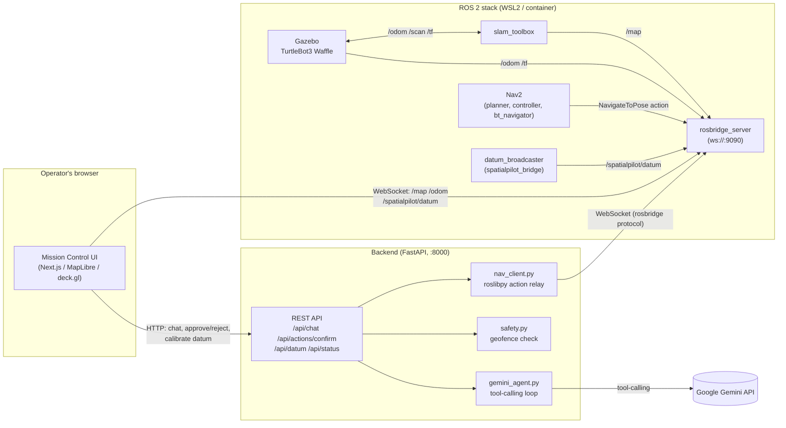
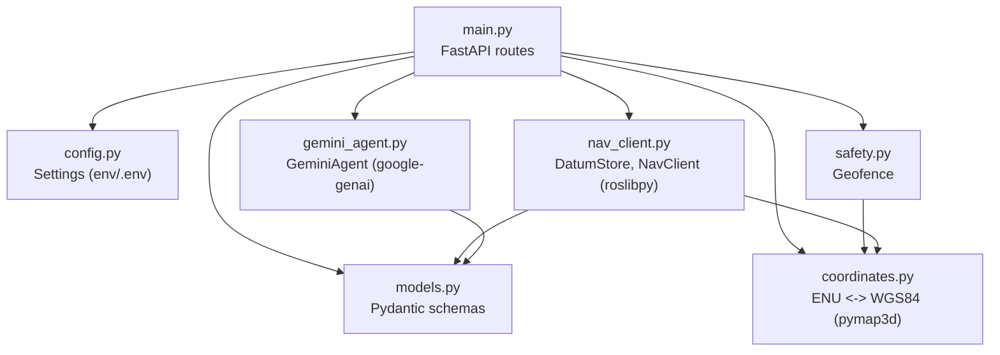
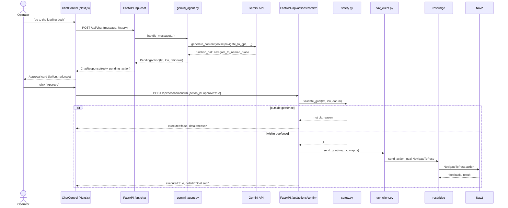
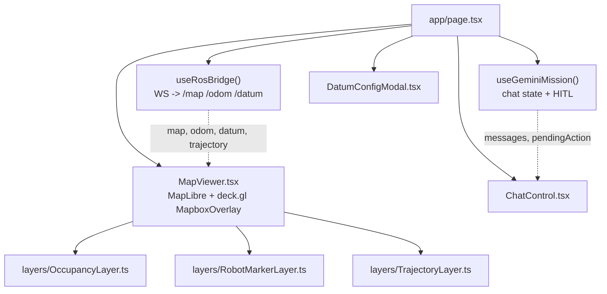
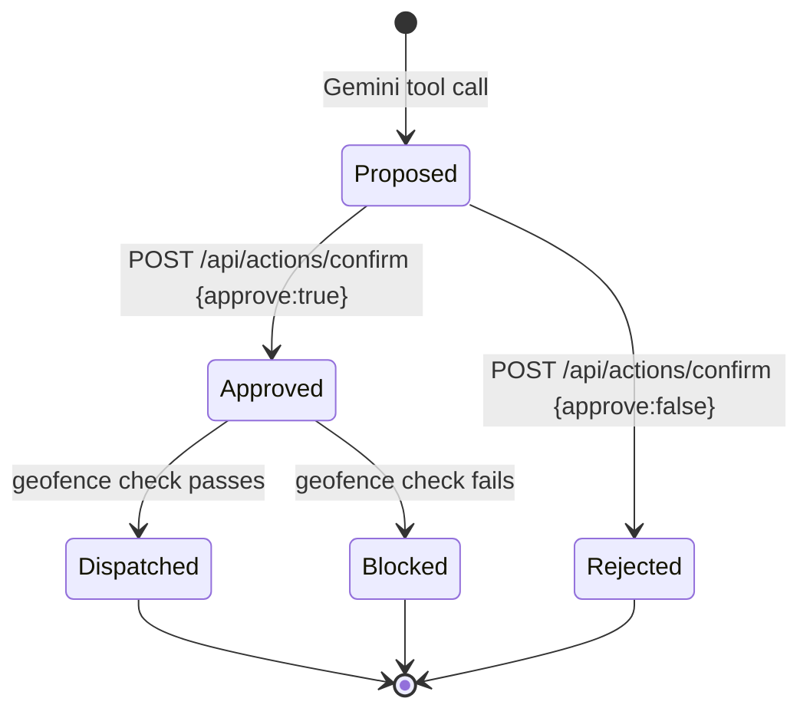

# SpatialPilot Architecture

## 1. High-Level Design (HLD)

SpatialPilot has three deployable units — a ROS 2 stack, a FastAPI backend, and a
Next.js frontend — plus one external dependency, the Gemini API. The browser talks
to two different servers directly: the backend for chat/HITL/calibration (HTTP),
and rosbridge for live telemetry (WebSocket). This split keeps high-frequency
sensor data (map/odom) off the backend's request path entirely.

Key architectural decisions:

- **Human-In-The-Loop is structural, not a UI convention.** Gemini's navigation
  tool calls never reach `nav_client.py` directly — `gemini_agent.py` can only
  return a `PendingAction`. Only `/api/actions/confirm`, triggered by an explicit
  operator click, calls `nav_client.send_goal()`, and only after `safety.py`
  re-validates the goal against the geofence.
- **Telemetry bypasses the backend.** The frontend subscribes to `/map`, `/odom`,
  and `/spatialpilot/datum` straight from rosbridge over WebSocket. Routing
  10Hz+ occupancy-grid/odometry data through the FastAPI process would add
  latency and load for no benefit — the backend only needs pose data for
  `get_robot_status` tool calls and geofence checks, which it polls on demand.
- **One geodetic datum, two consumers.** `datum_broadcaster.py` is the source of
  truth on the ROS side (latched topic); `coordinates.py` (Python, ellipsoidal
  via pymap3d) and `lib/coordinates.ts` (TypeScript, flat-earth approximation)
  both implement the same ENU→WGS84 rotation from it — see `coordinates.ts`'s
  docstring for why the frontend's approximation is intentional.

## 2. Low-Level Design (LLD)

### 2.1 Backend module dependencies

### 2.2 Sequence: natural-language navigation with HITL approval

This is the critical path — every safety property the system has lives in the
gap between the first and second `POST`.

### 2.3 Frontend component tree

### 2.4 Data model: `PendingAction` lifecycle

A `PendingAction` is created by `gemini_agent.py`, held server-side in
`main.py`'s in-memory `_pending_actions` dict (keyed by `action_id`), and
consumed exactly once by `/api/actions/confirm` — approving or rejecting always
pops it, so a given action can only ever be executed once.

